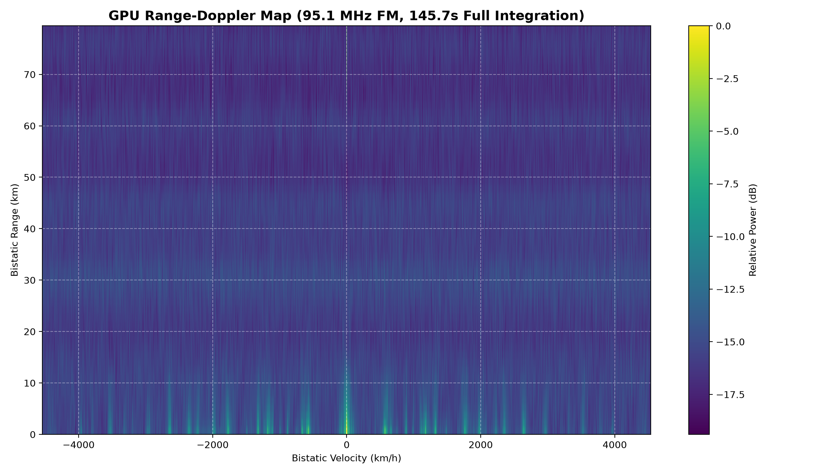
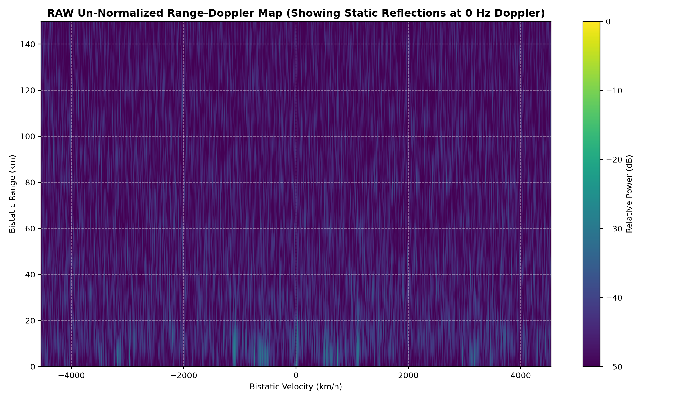
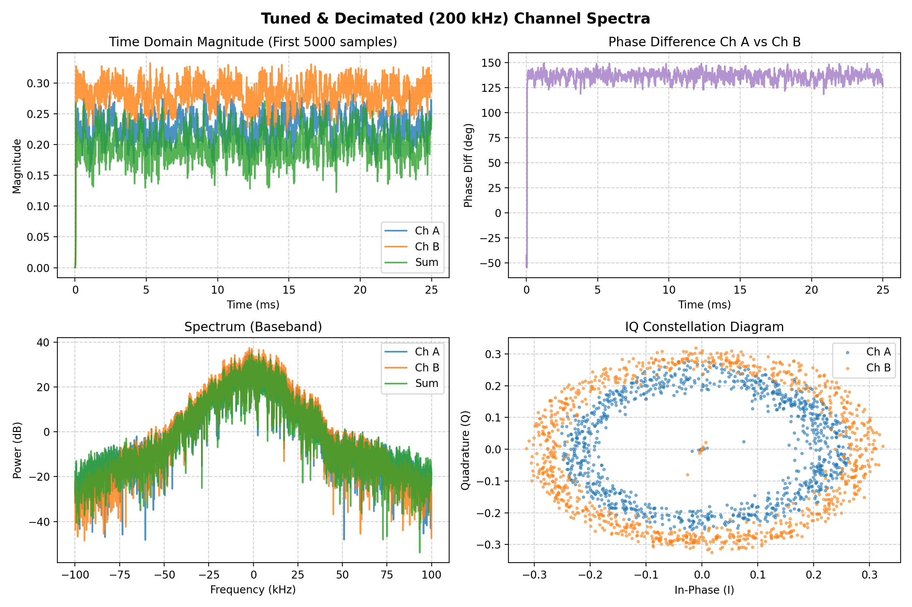
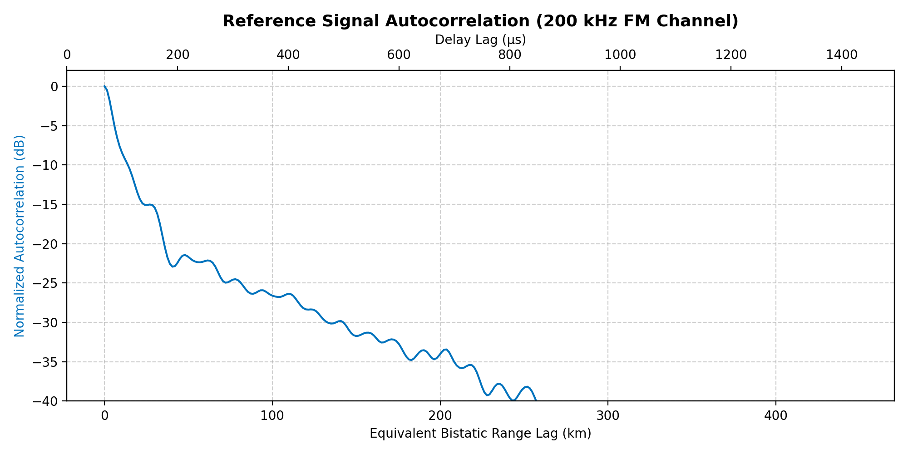
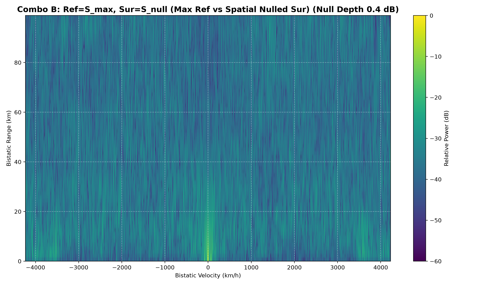
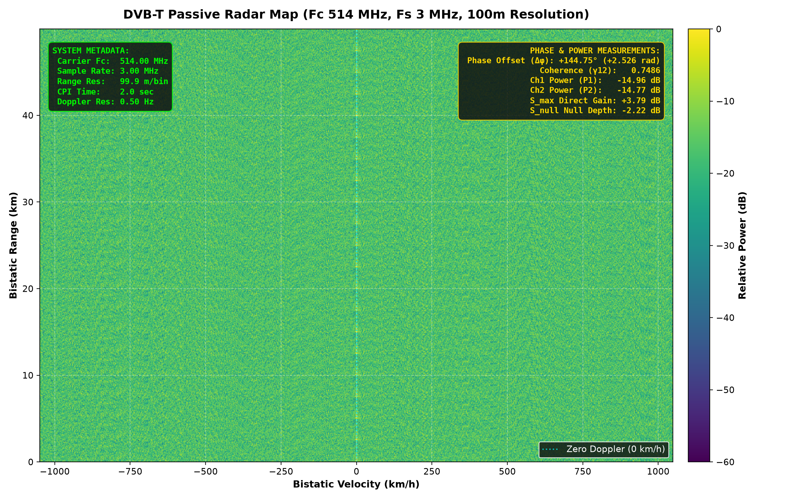

# PassiveRadarOffline

Offline passive bistatic radar processing of recorded 2-channel IQ data (FM radio & DVB-T illuminators) by **OK2AMA**.

## Features
- Cross-Ambiguity Function (range-Doppler map) on CPU and GPU (CuPy)
- Optional clutter cancellation / zero-Doppler suppression
- Long-recording non-coherent integration
- Two-element (λ/2 spaced omni) phasing: sum for max direct signal / null of direct signal, with annotated phases and powers
- FM (200 kHz) and DVB-T (514 MHz, 3 MS/s) support

## Usage
```bash
./scripts/install.sh
./scripts/run.sh
```
Place IQ recordings into `IQ/` (not included in repo – too large). Configure in `config.json`.

## Sample outputs
| | |
|---|---|
|  95.1 MHz FM – GPU RDM |  Raw static reflections |
|  Channel spectra |  Autocorrelation |
|  Phased max vs null |  DVB-T phased null (annotated) |
